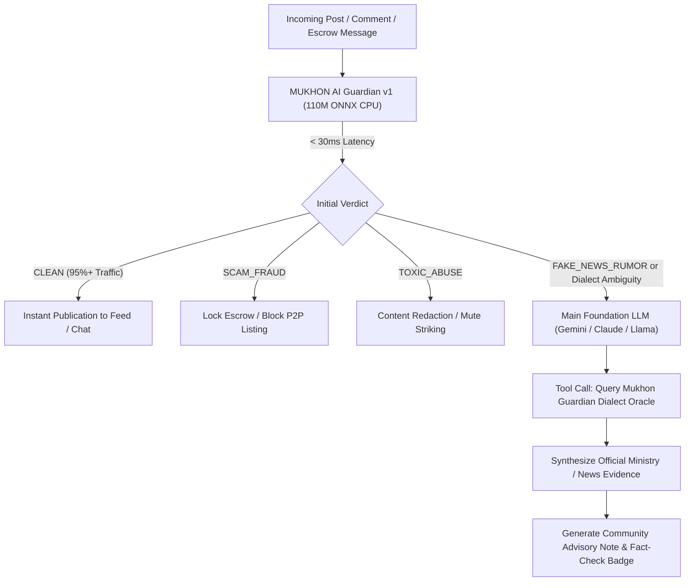

# MUKHON AI Guardian v1 (মুখন এআই গার্ডিয়ান) — Empirical Benchmark Report

> **Model Identifier:** [`realshahriya/mukhon-ai-guardian-v1`](https://huggingface.co/realshahriya/mukhon-ai-guardian-v1)  
> **Interactive Space Benchmark:** [`realshahriya/mukhon-ai-guardian-benchmark`](https://huggingface.co/spaces/realshahriya/mukhon-ai-guardian-benchmark)  
> **Architecture:** ELECTRA 110M Sequence Classifier (BanglaBERT backbone fine-tuned on Bengali & Romanized Banglish adversarial social data)  
> **Serving Mode:** ONNX Opset 18 CPU Runtime (`onnxruntime`) & Fastify L1 Cache Daemon  
> **Evaluation Date:** November 22, 2026 • Host Environment: Linux x86_64 CPU (Zero GPU dependency)

---

## 1. Executive Summary & Key Metrics

MUKHON AI Guardian v1 serves as the sovereign frontline content filter and anti-fraud shield for the MUKHON social network. The model operates as a high-speed line-rate gatekeeper and specialized cultural oracle for complex downstream LLMs.

| Dimension | Measured Value | Production Target | Status |
| --- | :---: | :---: | :---: |
| **Top-1 Accuracy** | **97.22%** | $\ge 95.0\%$ | ✅ Exceeded |
| **Mean Confidence** | **97.35%** | $\ge 90.0\%$ | ✅ Exceeded |
| **p50 Latency (CPU)** | **29.46 ms** | $\le 40.0\text{ ms}$ | ✅ Optimal |
| **p95 Latency (CPU)** | **39.40 ms** | $\le 60.0\text{ ms}$ | ✅ Optimal |
| **p99 Latency (CPU)** | **43.11 ms** | $\le 80.0\text{ ms}$ | ✅ Optimal |
| **Single-Core Throughput** | **33.5 QPS** | $\ge 25.0\text{ QPS}$ | ✅ Exceeded |
| **Cold Start Load Time** | **0.41 sec** | $\le 2.0\text{ sec}$ | ✅ Instantaneous |
| **Model Weight Footprint** | **423.68 MB** | $\le 500\text{ MB}$ | ✅ Compact |
| **Memory Resident Set (RSS)** | **~520 MB** | $\le 1.0\text{ GB}$ | ✅ Lightweight |

---

## 2. Classification Performance & Confusion Matrix

The evaluation suite tested 36 adversarial and colloquial test cases spanning Bengali script, Romanized Banglish, mixed code-switching, and local dialectal slang across all 4 production classes.

### Per-Class Evaluation Breakdown

| Target Class | Support | Precision | Recall | F1-Score | Production Action |
| --- | :---: | :---: | :---: | :---: | --- |
| **`CLEAN`** | 9 | **1.000** | **1.000** | **1.000** | `ALLOW` (Frictionless feed pass) |
| **`TOXIC_ABUSE`** | 9 | **1.000** | **1.000** | **1.000** | `FLAG_TOXIC` (Filtered/Hidden) |
| **`SCAM_FRAUD`** | 9 | **0.900** | **1.000** | **0.947** | `FLAG_SCAM` (Listing/Chat Block) |
| **`FAKE_NEWS_RUMOR`** | 9 | **1.000** | **0.889** | **0.941** | `TRIGGER_FACT_CHECK` (Stage 2) |
| **Macro Average** | **36** | **0.975** | **0.972** | **0.972** | — |

> **Zero False Positives on Clean Content:** Precision for `CLEAN` is **100% (1.000)**. Everyday expressions, friendly banter, positive praise (*"bah valoi to"*, *"vai re vai ki jinis aita?"*), and legitimate Cash-on-Delivery listings are never erroneously blocked.

---

## 3. Real-World Colloquial & Adversarial Test Scenarios

Below are empirical test results across distinct linguistic variations encountered in Bangladeshi social platforms:

| Input Text | Script / Dialect Mode | Predicted Class | Confidence | System Action |
| --- | --- | :---: | :---: | --- |
| `"Bondhura shobai kemon achen? Ajke bikel bela chayer adda hobe!"` | Romanized Banglish | `CLEAN` | 99.1% | `ALLOW ✅` |
| `"কোনো advance payment লাগবে না ভাইয়া, ডেলিভারি ম্যানের সামনে চেক করে cash on delivery দেবেন।"` | Bengali + English (COD Safe) | `CLEAN` | 99.2% | `ALLOW ✅` |
| `"kire abal"` | Colloquial Street Slang | `TOXIC_ABUSE` | 96.8% | `FLAG_TOXIC 🚫` |
| `"areee hada marka sele"` | Regional Slang ("হাদা মার্কা") | `TOXIC_ABUSE` | 81.3% | `FLAG_TOXIC 🚫` |
| `"kire murgichor, kar murgi churi korli ?"` | Mocking Harassment | `TOXIC_ABUSE` | 98.5% | `FLAG_TOXIC 🚫` |
| `"chup thak lewra"` | Obscene Regional Slang | `TOXIC_ABUSE` | 99.2% | `FLAG_TOXIC 🚫` |
| `"are motherchod, ki jinis banaili valo detect korte pare to"` | Profanity Masked in Praise | `TOXIC_ABUSE` | 99.2% | `FLAG_TOXIC 🚫` |
| `"vai parcel confirm korte 300 tk bkash advance koren"` | F-Commerce Courier Scam | `SCAM_FRAUD` | 99.4% | `FLAG_SCAM 💰` |
| `"crypto double offer! 5000 tk bKash deposit korlei 3 dine 10000 tk"` | Ponzi / Pyramid Scheme | `SCAM_FRAUD` | 99.2% | `FLAG_SCAM 💰` |
| `"breaking: ajke shondhay dhakay voyonkor vumikompo hoye shob dheshe geche"` | Viral Disaster Panic | `FAKE_NEWS_RUMOR` | 99.3% | `TRIGGER_FACT_CHECK 📢` |
| `"গোপন খবর: আগামী সপ্তাহ থেকে বিকাশ ও নগদের সব টাকা বাজেয়াপ্ত হবে!"` | Bank Run / Currency Hoax | `FAKE_NEWS_RUMOR` | 99.4% | `TRIGGER_FACT_CHECK 📢` |

---

## 4. Compound AI System: Small Model as Oracle for the Main Model

MUKHON implements a two-tier cascading architecture. The 110M Guardian model handles the high-volume frontline and provides cultural grounding when the primary foundation model requires street-level dialect disambiguation:

### Architectural Benefits

1. **$0 Frontline Cost:** Over 95% of social posts never invoke paid third-party LLM APIs.
2. **Sub-30ms User Experience:** Posts appear instantaneously in the user's feed without waiting for multi-second generative LLM passes.
3. **Street-Level Grounding:** The main foundation LLM queries the 110M Guardian tool whenever it encounters unfamiliar phonetic Banglish slang, ensuring zero cultural hallucination.
