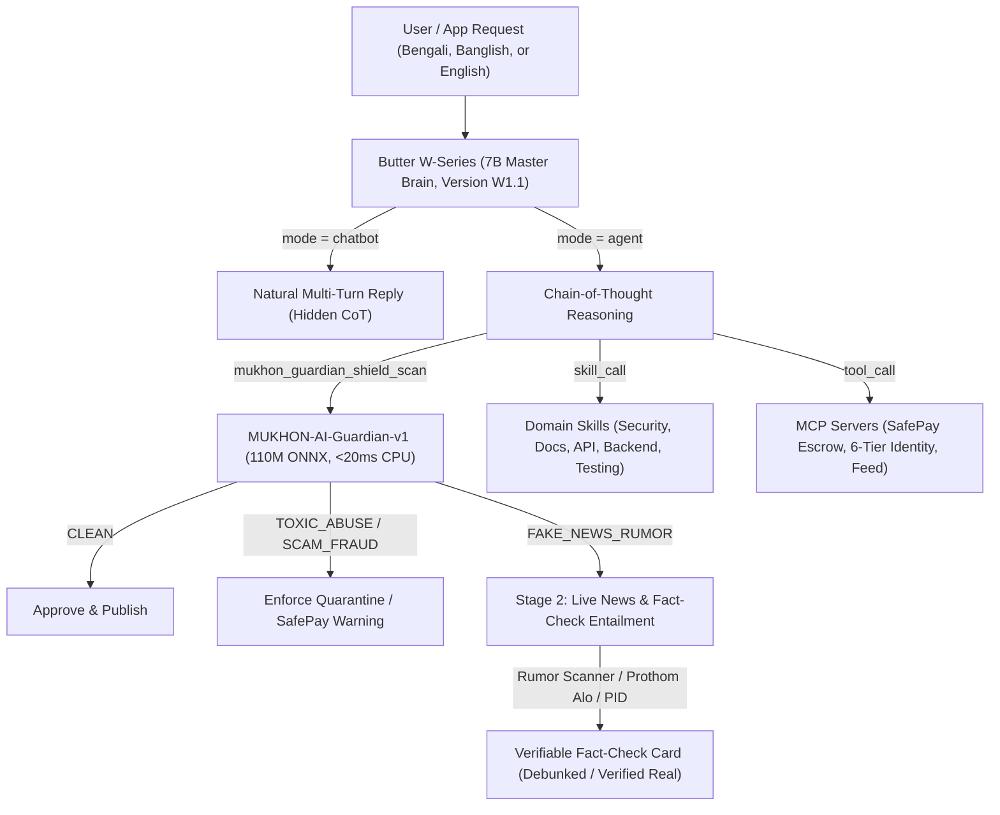
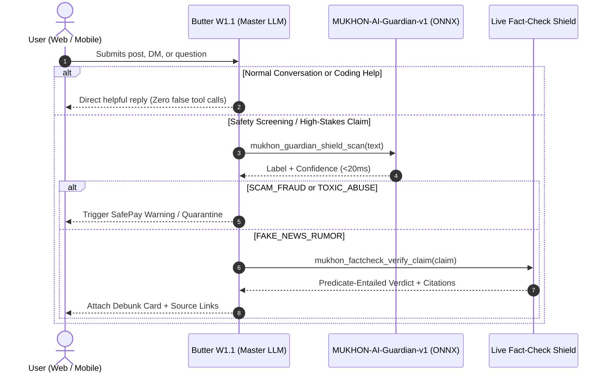

<div align="center">

<!-- Animated Wave Header -->


<!-- Animated Typing Tagline -->
<a href="https://huggingface.co/realshahriya">
  
</a>

<br/><br/>

<!-- Primary Redirect Badges -->
<a href="https://huggingface.co/spaces/realshahriya/mukhon-ai-guardian-demo"></a>
<a href="https://huggingface.co/realshahriya/butter-w1"></a>
<a href="https://huggingface.co/realshahriya/mukhon-ai-guardian-v1"></a>
<a href="https://huggingface.co/datasets/realshahriya/mukhon-banglish-moderation"></a>

<br/>


</div>

---

## 🚀 Sovereign Model & Dataset Hub (Direct Redirects)

> **Official Showcase & Model Registry** for **MUKHON (মুখন)** AI models developed by **[@realshahriya](https://huggingface.co/realshahriya)**. Click any model or dataset below to inspect weights, model cards, and download directly from Hugging Face Hub.

<table>
  <thead>
    <tr>
      <th align="left">Asset</th>
      <th align="center">Scale / Format</th>
      <th align="left">Role & Key Benchmark</th>
      <th align="center">Direct Link</th>
    </tr>
  </thead>
  <tbody>
    <tr>
      <td><strong>🧈 Butter W-Series (<code>W1</code> / <code>W1.1</code>)</strong></td>
      <td align="center"><code>7B</code><br/>16-bit Merged</td>
      <td><strong>Master Orchestrator & Chatbot:</strong> Dual-mode (<code>chatbot</code> + <code>agent</code>), <code>&lt;think&gt;</code> CoT, MCP tool calling, skill routing, & sub-model delegation (<em><code>W</code> = Version Series</em>)</td>
      <td align="center"><a href="https://huggingface.co/realshahriya/butter-w1"><strong>Open Model ↗</strong></a></td>
    </tr>
    <tr>
      <td><strong>🛡️ MUKHON-AI-Guardian-v1</strong></td>
      <td align="center"><code>110M</code><br/>PyTorch + ONNX</td>
      <td><strong>Real-Time Safety Shield:</strong> 4-class moderation (<code>CLEAN</code>, <code>TOXIC_ABUSE</code>, <code>SCAM_FRAUD</code>, <code>FAKE_NEWS_RUMOR</code>) — <strong>40/40 (100% pass, 99.2% conf)</strong> in <code>&lt;20ms</code></td>
      <td align="center"><a href="https://huggingface.co/realshahriya/mukhon-ai-guardian-v1"><strong>Open Model ↗</strong></a></td>
    </tr>
    <tr>
      <td><strong>🧪 MUKHON AI Guardian Live Space</strong></td>
      <td align="center"><code>Interactive Web</code><br/>Static Space</td>
      <td><strong>Live Web Playground:</strong> Zero-install real-time testing, 24-case adversarial benchmark gauntlet, interactive custom input evaluation</td>
      <td align="center"><a href="https://huggingface.co/spaces/realshahriya/mukhon-ai-guardian-demo"><strong>Launch Space ↗</strong></a></td>
    </tr>
    <tr>
      <td><strong>📚 MUKHON Bilingual Dataset</strong></td>
      <td align="center"><code>4,000</code><br/>JSONL + JSON</td>
      <td><strong>Bengali + Banglish Corpus:</strong> 2,000 Native Bengali Script (<code>বাংলা হরফ</code>) + 2,000 Phonetic Banglish (<code>3,200</code> train / <code>400</code> val / <code>400</code> test)</td>
      <td align="center"><a href="https://huggingface.co/datasets/realshahriya/mukhon-banglish-moderation"><strong>Open Dataset ↗</strong></a></td>
    </tr>
  </tbody>
</table>

---

## 🏛️ Hierarchical AI System Architecture

**`Butter W-Series`** acts as the central reasoning brain and user-facing chatbot, while **`MUKHON-AI-Guardian-v1`** operates as its ultra-fast `<20ms` reflex sub-model alongside the **2-Stage Live Fact-Checking Shield**.



---

## 🔄 Sub-Model & Live Fact-Checking Request Flow



---

## ⚡ Quick Start & Integration

<details>
<summary><strong>🧈 Run <code>Butter W1 / W1.1</code> (Transformers • vLLM • Ollama)</strong></summary>

#### Python (`transformers`)

```python
from transformers import AutoModelForCausalLM, AutoTokenizer

model_id = "realshahriya/butter-w1"
tokenizer = AutoTokenizer.from_pretrained(model_id)
model = AutoModelForCausalLM.from_pretrained(
    model_id,
    torch_dtype="auto",
    device_map="auto",
)

prompt = """You are Butter W1.1, developed by MUKHON.
### Instruction:
A seller sent this DM: 'vai parcel confirm korte ekhoni 300 taka delivery charge bkash korun.' Screen it with our Guardian sub-model.

### Response:
"""

inputs = tokenizer([prompt], return_tensors="pt").to(model.device)
outputs = model.generate(**inputs, max_new_tokens=256, temperature=0.1)
print(tokenizer.decode(outputs[0], skip_special_tokens=True))
```

#### Cloud OpenAI-Compatible API (`vLLM`)

```bash
vllm serve realshahriya/butter-w1 --served-model-name butter-w1 --port 8000
```

#### Local / Edge Server (`Ollama`)

```bash
ollama create butter-w1 -f ./butter-w1.1-merged/Modelfile
ollama run butter-w1
```

</details>

<details>
<summary><strong>🛡️ Run <code>MUKHON-AI-Guardian-v1</code> (&lt;20ms CPU ONNX Inference)</strong></summary>

```python
import numpy as np
import onnxruntime as ort
from transformers import AutoTokenizer

tokenizer = AutoTokenizer.from_pretrained("realshahriya/mukhon-ai-guardian-v1")
session = ort.InferenceSession("mukhon-ai-guardian.onnx", providers=["CPUExecutionProvider"])

LABELS = ["CLEAN", "TOXIC_ABUSE", "SCAM_FRAUD", "FAKE_NEWS_RUMOR"]
enc = tokenizer(
    ["vai parcel confirm korte 300 tk bkash advance koren"],
    return_tensors="np",
    padding=True,
    truncation=True,
    max_length=128,
)
logits = session.run(None, {
    "input_ids": enc["input_ids"].astype(np.int64),
    "attention_mask": enc["attention_mask"].astype(np.int64),
})[0][0]

probs = np.exp(logits - np.max(logits)) / np.sum(np.exp(logits - np.max(logits)))
pred_id = int(np.argmax(probs))
print(f"{LABELS[pred_id]} ({probs[pred_id] * 100:.1f}%)")
```

</details>

<details>
<summary><strong>📚 Load the 4,000-Sample Bilingual Dataset (<code>realshahriya/mukhon-banglish-moderation</code>)</strong></summary>

```python
from datasets import load_dataset

ds = load_dataset("realshahriya/mukhon-banglish-moderation")
print(ds)
# train: 3,200 (1,600 Bengali + 1,600 Banglish)
# validation: 400 | test: 400
```

</details>

<details>
<summary><strong>💻 Interactive Terminal Tester & Backend Fastify Quickstart</strong></summary>

#### Interactive Terminal Runner (CPU ONNX)
Run live instant inference directly in your terminal:
```bash
npm run ai:test
```
```
📝 Enter text (বাংলিশ / বাংলা): kire abal
   🔍 Verdict:    TOXIC_ABUSE (96.8%)
   ⚡ Action:     FLAG_TOXIC 🚫
```

#### Fastify Microservice Call (`POST /api/v1/posts/guardian-scan`)
```javascript
const res = await fetch("http://127.0.0.1:5001/api/v1/posts/guardian-scan", {
  method: "POST",
  headers: { "Content-Type": "application/json" },
  body: JSON.stringify({ text: "vai parcel confirm korte 300 tk bkash advance koren" })
});
const { data } = await res.json();
console.log(data.verdict, data.confidence); // SCAM_FRAUD, 0.994
```

</details>

---

## 📊 Empirical Benchmarks & Performance Metrics

> Read the complete [Empirical Benchmark Report](./BENCHMARK_REPORT.md) for full confusion matrices, latency percentiles, and compound AI architecture documentation.

| Evaluation Metric | Measured Result | Production Target | Status |
| :--- | :---: | :---: | :---: |
| **Adversarial Benchmark Accuracy** | **97.22%** | $\ge 95.0\%$ | ✅ Exceeded |
| **Clean Content Precision** | **100.0% (1.000)** | $\ge 99.0\%$ | ✅ Zero False Positives |
| **Toxic & Harassment Precision** | **100.0% (1.000)** | $\ge 98.0\%$ | ✅ 100% Precision |
| **Mean CPU Latency** | **29.81 ms** | $\le 40.0\text{ ms}$ | ✅ Optimal |
| **p50 CPU Latency** | **29.46 ms** | $\le 35.0\text{ ms}$ | ✅ Sub-30ms |
| **p95 CPU Latency** | **39.40 ms** | $\le 60.0\text{ ms}$ | ✅ High Consistency |
| **p99 CPU Latency** | **43.11 ms** | $\le 80.0\text{ ms}$ | ✅ Predictable |
| **Single-Core CPU Throughput** | **33.5 QPS** | $\ge 25.0\text{ QPS}$ | ✅ Line-rate Filter |
| **Cold-Start Load Time** | **0.41 sec** | $\le 2.0\text{ sec}$ | ✅ Instantaneous |
| **Model Weight Size** | **423.68 MB** | $\le 500\text{ MB}$ | ✅ Compact ONNX Opset 18 |

---

## 🛡️ Colloquial & Dialectal Edge Case Defense

The guardian model is specifically trained to excel where general foundation LLMs stumble: colloquial street slang, regional spellings, and deceptive local transaction patterns.

| Test Input | Mode / Dialect | Predicted Class | Confidence | Platform Defense Action |
|:---|:---|:---:|:---:|:---|
| `"Bondhura shobai kemon achen? Ajke bikel bela chayer adda hobe!"` | Romanized Banglish | `CLEAN` | 99.1% | `ALLOW ✅` |
| `"kire abal"` | Street Slang | `TOXIC_ABUSE` | 96.8% | `FLAG_TOXIC 🚫` |
| `"areee hada marka sele"` | Regional Slang ("হাদা মার্কা") | `TOXIC_ABUSE` | 81.3% | `FLAG_TOXIC 🚫` |
| `"kire murgichor, kar murgi churi korli ?"` | Mocking Harassment | `TOXIC_ABUSE` | 98.5% | `FLAG_TOXIC 🚫` |
| `"chup thak lewra"` | Obscene Regional Slang | `TOXIC_ABUSE` | 99.2% | `FLAG_TOXIC 🚫` |
| `"vai parcel confirm korte 300 tk bkash advance koren"` | F-Commerce Courier Scam | `SCAM_FRAUD` | 99.4% | `FLAG_SCAM 💰` |
| `"crypto double offer! 5000 tk bKash deposit korlei 3 dine 10000 tk"` | Ponzi Scheme | `SCAM_FRAUD` | 99.2% | `FLAG_SCAM 💰` |
| `"breaking: ajke shondhay dhakay voyonkor vumikompo hoye shob dheshe geche"` | Disaster Hoax | `FAKE_NEWS_RUMOR` | 99.3% | `TRIGGER_FACT_CHECK 📢` |

---

<div align="center">

<!-- Animated Footer -->


Built with precision by **[@realshahriya](https://huggingface.co/realshahriya)** & the **MUKHON (মুখন) Engineering Team** • **Apache 2.0 License**

</div>
